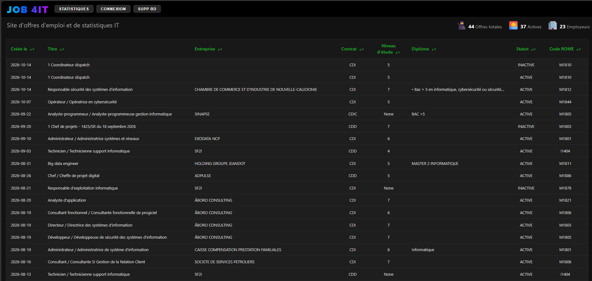
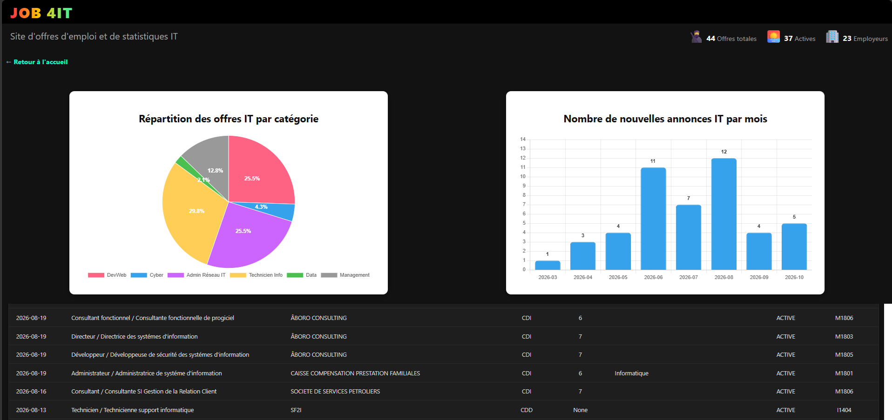

# Le projet JOB 4IT

## Fonctionnement général

- Le site récupère l'ensemble des offres d'emploi sur le site data.gouv.nc au format JSON
- Ensuite elles sont stockées dans un base de données SQL
- Au lancement du serveur, la route de la page d'accueil va chercher dans la base de données les offres d'emploi IT et les affiche dans un tableau.
- Cliquer sur une annonce lance une route pour ouvrir un template detail.ejs (les détails de l'annonce)

## Les boutons

- `Connexion` : se connecte à l'API data.gouv, récupère toutes les annonces, affiche une barre de progression, rafraîchit la page
- Cela n'écrase pas à chaque fois la bd: c'est pour détecter les changements dans les annonces (passage de actif à inactif, etc...)
- `Supp BD` : c'est un bouton de test, pour vérifier que ça marche, on supprime un certain code ROM de la bd, pouvoir si `Connexion` fonctionne bien
- `STATISTIQUES` : renvoie sur deux graphiques. 

## La source de données: l'API de data.gouv

- Malheureusement cette source de données n'est pas très fiable. Sur le site emploi.nc (du gouvernement), on retrouve peu d'annonces qui sont pourtant actives dans l'API. Il y a même des annonces qui n'apparaîssent pas dans le site emploi.nc mais qui sont dans le json et présentes sur d'autres sites ! (ex: RHNC). Il y a un gros problème visiblement avec le moteur de recherche.
- Aussi, il y a peu de données: le site explique qu'en mars 2026 ils ont créé une nouvelle version de l'API, la V2.1, et sont repartis sur un nouveau format.

## Axes d'amélioration

- Intégrer les données d'avant mars 2026 : j'ai préféré me concentrer sur les fonctionnalités plutôt que le data collection.
- Intégrer d'autres sites en les scrappant: ABORO CONSULTING ou RHNC ont des offres que le gouvernement n'a pas. Je pensais que ce dernier récoltant la liste exhaustive de toutes les offres du territoire.
- Intégrer d'autres indicateurs: évolution du nombre d'annonces en DevWeb (pour voir l'impact de l'IA ?!), ou même de chaque secteur, un graphe avec les entreprises qui recrutent le plus, etc...

## Autres read*.md

- read_howto.md   : rappelle à la manière du TP5 comment mettre en place tout l'environnement Node, express, Git, etc... en vue de partage ou de fiche de révision
- read_json.md    : un petit tuto sur le format JSON

## Aperçu de l'application

